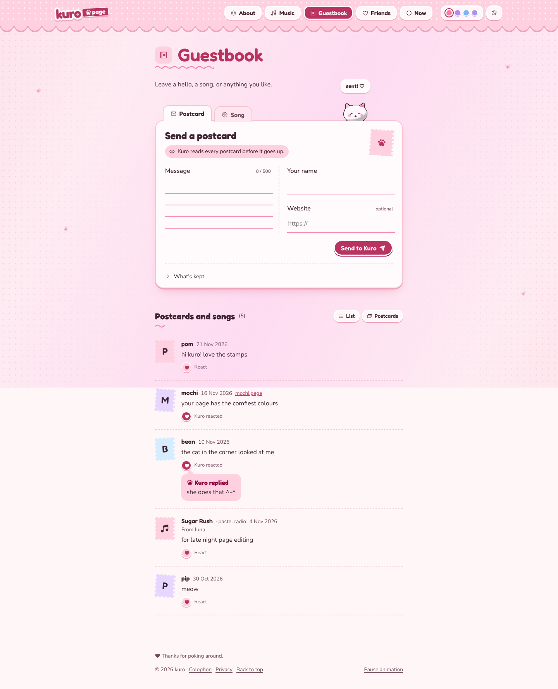
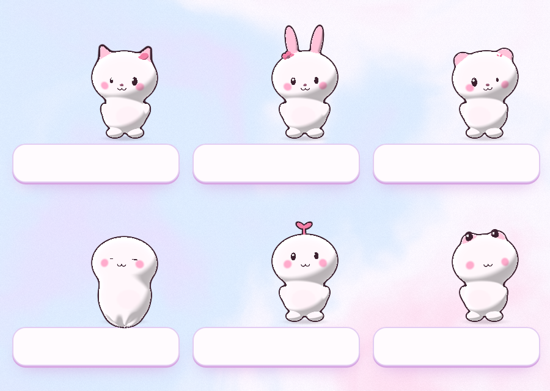
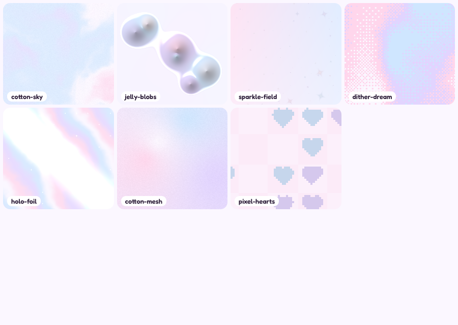
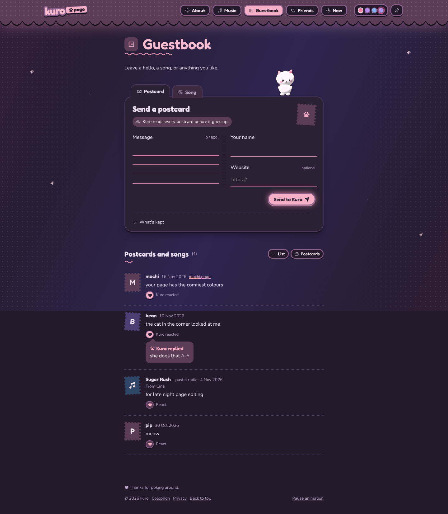
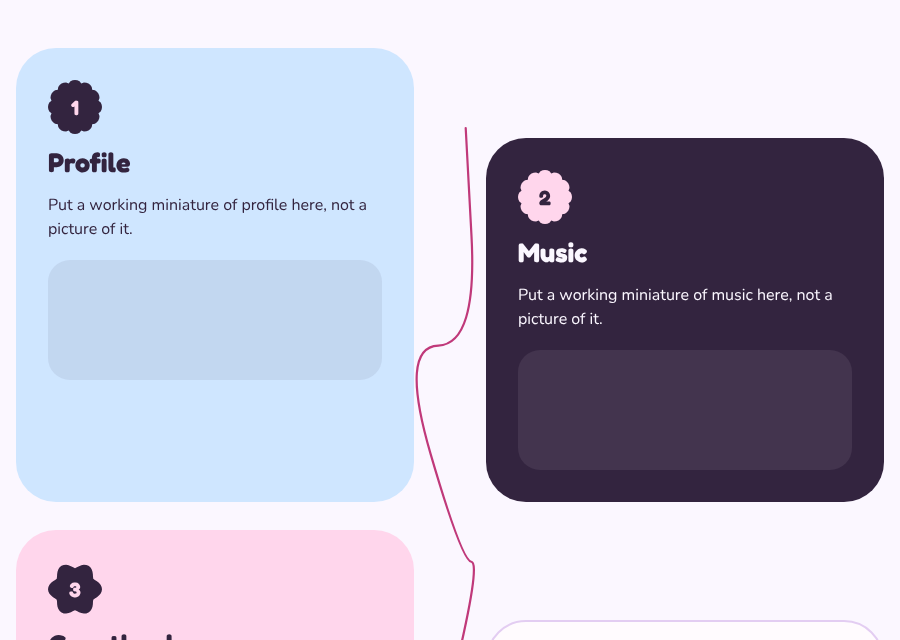

# cute-core ♡

A Claude skill that designs cutecore interfaces: pastel pink, purple and blue,
stickers and stamps and postcards, a little WebGL creature that notices you, and
zero tolerance for generic AI layouts.



## What it does

- **House style** modelled closely on chessie.cat's guestbook (scalloped
  halftone awning, die-cut sticker buttons, stamp avatars, lined paper fields,
  reactions, reply bubbles, sparkle sky, motion toggle), then expanded with
  strawberry / grape / blueberry / cotton flavours, dark mode and more.
- **Real 21st.dev icons, never hand drawn**: search and fetch from the ~29k icon
  catalogue (lucide, phosphor, tabler, hugeicons, remix, heroicons, line-md and
  animated sets) as SVG, React, Vue or data URLs, with optional doodle line boil,
  sticker outline and hover animations layered on the real geometry.
- **Every 21st.dev category, cutecore-ified**: candy glass dashboards, jelly
  liquid glass, doodle, retro, feature trails (blushie.gg), device frames
  (ivy.rest, lwsg.space), invented bentos that refuse cliché grids.
- **WebGL, zero dependencies**: seven shader backgrounds (cotton sky, jelly
  blobs, sparkle field, dither dream, holo foil, cotton mesh, pixel hearts) and a
  ray-marched mascot (cat, bunny, bear, ghost, blob, frog) that follows the
  cursor, wanders, perches on cards or peeks over them, and can be matched to a
  site's own mascot.
- **Reverse engineering**: `dissect.cjs` turns any URL into a blueprint
  (screenshots, layout tree, tokens, keyframes, libraries, live APIs,
  listeners, source files) for faithful 1:1 rebuilds, for example as a layout
  on kuro.rip. Rebuilds keep the recipe and use your own content and art.
- **Discovery**: `cute_scrape.py` crawls outward from the curated sites,
  scores pages for cutecore-ness and keeps a token-only corpus (robots.txt
  respected, no personal data stored).
- **De-AI gates**: `deslop.py` fails on em dashes, serif fonts, hand drawn
  icons and lorem, and warns on SaaS skeletons, stock copy and sameness;
  `feature_guard.py` proves a redesign removed nothing.
- **Deviation scale + variants + memory**: always asks how far to deviate
  (1 to 10), plans up to 5 genuinely different variants, builds a gallery to
  pick from, and remembers what you picked, loved and disliked.

| | |
|---|---|
|  |  |
|  |  |

## Install

**Claude Code, as a plugin (recommended)**

```bash
claude plugin marketplace add reputing/cute-core
```
```bash
claude plugin install cutecore@cute-core
```

Or inside a session: `/plugin marketplace add reputing/cute-core`, then
`/plugin install cutecore@cute-core`.

**Claude Code, one line**

```bash
curl -fsSL https://raw.githubusercontent.com/reputing/cute-core/main/install.sh | bash
```

Add `-s -- --project` to install into the current project's `.claude/skills`,
or `-s -- --with-browser` to also install Playwright + Chromium for the
dissect and screenshot tools. From a clone: `bash install.sh`.

**claude.ai**

Upload `dist/cutecore.skill` under Settings, Capabilities, Skills.

**Requirements**: Python 3.9+ (standard library only). Node 18+ with Playwright
only for `dissect.cjs` and variant screenshots. Network access to 21st.dev for
icons. A 21st API key (`API_KEY_21ST`) only if you want to install 21st
components directly; browsing, icons and inspiration are free.

## Use

Just ask. It triggers on cute, kawaii, pastel, y2k, cozy, cutecore, kuro.rip,
guestbooks, mascots, cute shaders, 21st.dev components, or "make this less generic".

> make my kuro.rip guestbook cutecore
>
> reverse engineer blushie.gg's feature section and rebuild it as a kuro layout
>
> give me a candy glass version of this dashboard, keep every chart

It will ask how far to deviate and how many variants you want, then show you a
gallery to pick from.

## Tools (in `skills/cutecore/scripts/`)

| script | does |
|---|---|
| `icons21.py` | search, fetch, pack and inline 21st.dev icons (+ doodle, sticker, animate) |
| `components21.py` | browse / read / search 21st.dev components and libraries, print install commands |
| `dissect.cjs` | reverse engineer a live page into a blueprint with screenshots |
| `cute_scrape.py` | discover cutecore sites from the curated seeds, build a token corpus |
| `deslop.py` | lint for em dashes, serif, SaaS skeletons, hand drawn icons, lorem |
| `feature_guard.py` | snapshot features before a redesign, fail if any disappear |
| `bento.py` | invent non-cliché bento layouts, feature trails, M3 style morphable shapes |
| `palette.py` | generate pink / purple / blue palettes with enforced contrast, audit token files |
| `variants.py` | plan distinct variants from a deviation level, build a pick gallery, screenshots |
| `memory.py` | remember picks, loves and dislikes per project |

Assets: `cute-tokens.css` (house tokens and primitives), `shader-canvas.js`,
`mascot.js`, `templates/guestbook.html` (the showcase above).

## Curated references

chessie.cat/guestbook (anchor), kuro.rip (target), blushie.gg, ivy.rest/v2,
schuh.wtf, rot.kim, lwsg.space, milproject.xyz, doll.gg. Add more in
`skills/cutecore/data/sites.json`; the crawler starts from there.
